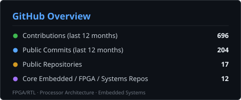
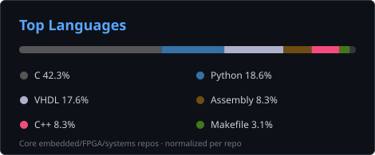

# Mehdi Bouama

**M2 SETI (Embedded Systems & Information Processing) · Université Paris-Saclay**

FPGA/RTL (VHDL) · Digital Design · SoC Integration · Processor Architecture · HW/SW Co-design

---

## About & Engineering Focus

- **Academic track:** M2 SETI (*Systèmes Embarqués et Traitement de l'Information*) at Université Paris-Saclay.
- **Hardware, FPGA & RTL:** VHDL RTL design (FSMs, datapaths, multicycle processors), Intel Quartus Prime, exhaustive self-checking verification with GHDL, and FPGA board integration (Terasic DE1-SoC / DE1).
- **SoC & Embedded Systems:** Nios II soft-core / Avalon-MM integration, bare-metal & Linux C11/C++ firmware, POSIX concurrency, I2C/UART/PWM peripherals, Raspberry Pi, STM32, and ESP32.
- **Computer Architecture:** 5-stage pipeline hazard & scheduling analysis (MIPS64), L1 cache/TLB hierarchy modeling, and x86-64 microbenchmarking.

---

## Selected Projects

| Project | Domain | Verified Highlights |
|---|---|---|
| [DE1-SoC Nios II I2C Thermometer](https://github.com/mahdidou711/de1-soc-nios2-i2c-mcp9808) | SoC · HW/SW Co-design | Nios II/f & Avalon-MM on DE1-SoC · software I2C master for MCP9808 · 250 ms Timer2 IRQ · VHDL 7-segment display · C99 host tests & GHDL syntax checks |
| [8-bit Multicycle Processor](https://github.com/mahdidou711/vhdl-8bit-multicycle-processor) | FPGA · Processor Architecture | Extends a university VHDL CPU · 7-state control FSM · 12-op registered ALU · 1,573,888 exhaustive GHDL vectors · 8-testbench regression · DE1 port prep · CI |
| [CPU Architecture & Performance](https://github.com/mahdidou711/cpu-architecture-performance-analysis) | CPU · Microbenchmarking | x86-64 C benchmarks with fenced `RDTSCP` · loop order (`ijk` vs `ikj` 5.7× at N=1000), cache tiling, GCC `-O0`–`-O3`, multi-accumulator & ILP chains |
| [MIPS64 Pipeline Optimization](https://github.com/mahdidou711/mips64-pipeline-optimization) | CPU · Pipelining | Cycle-accurate 5-stage MIPS64 hazard & forwarding study in eduMIPS64 · 17 programs (34 configs) · loop unrolling (`daxpy` −55.9% cycles), load hoisting & multi-accumulators |
| [L1 Cache & TLB Simulator](https://github.com/mahdidou711/cache-tlb-simulator) | Memory Hierarchy · C11 | Header-based L1 data cache (45 configs, LRU, 3C miss model, optional prefetch) & LRU TLB (6 configs, 1 KiB pages) on linear algebra kernels · unit tests |
| [Multitasking Accumulator](https://github.com/mahdidou711/multitasking-accumulator) | Embedded SW · Concurrency | C11/POSIX multithreaded pipeline on Linux (4 producers, 4-slot bounded buffer, adder, display) · mutex, C11 atomics & compare-exchange variants · PlantUML specs |
| [Sequential Search & Multiplier](https://github.com/mahdidou711/vhdl-search-multiplier) | FPGA · RTL Verification | Sequential 16×8-bit search FSM (`searchx`) · exhaustive 65,536-vector GHDL verification of an 8×8 shift-add multiplier (fellow student's RTL) · DE1 wrappers · CI |
| [CoVAPSy 2026](https://github.com/mahdidou711/mahdidou711-covapsy) | Autonomous Robotics | ENS Paris-Saclay 1/10-scale race car (team project; navigation & control SW) · configured 50 Hz reactive loop on Raspberry Pi 4 · RPLidar A2M12 · SRF10 sonar · CI |

---

## Technical Stack

**Hardware, FPGA & RTL**

**Systems, CPU & Embedded**

**Tooling & Verification**

---

## GitHub Stats & Languages

  
  &nbsp;
  

